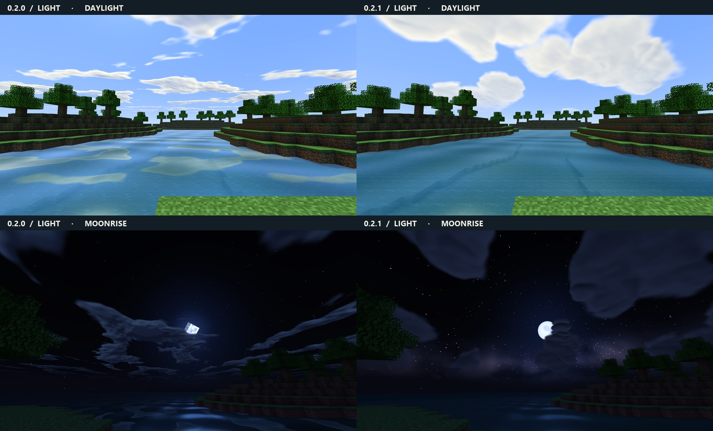

# DanPotatoShader

A shader pack for **Minecraft Java 1.21.1, Fabric, and Iris**, designed for Intel UHD integrated graphics. At a riverbank, the low sun lights the edges of stone and foliage, nearby trees cast shadows, and ripples break up the reflected sky. Both profiles include these effects.

**[Download DanPotatoShader 0.2.1 beta](https://github.com/Haigatu/DanPotatoShader/releases/download/v0.2.1-beta/DanPotatoShader-0.2.1-beta.zip)** · [Release notes](https://github.com/Haigatu/DanPotatoShader/releases/tag/v0.2.1-beta)



*Captured in Minecraft Java 1.21.1 on Intel UHD at a fixed shoreline. Each row uses the same camera, world time and Light settings. Clouds drift between captures.*

## Install

1. Use **Minecraft Java 1.21.1**, **64-bit Java 21**, and a compatible **Fabric Loader 0.16.0 or later**. Install the Fabric builds of Iris and Sodium for 1.21.1. The original 0.2 baseline used [Iris 1.8.8](https://modrinth.com/mod/iris/version/1.8.8%2B1.21.1-fabric) and [Sodium 0.6.13](https://modrinth.com/mod/sodium/version/mc1.21.1-0.6.13-fabric).
2. Open the shader pack folder from the Iris video settings and place **DanPotatoShader-0.2.1-beta.zip** inside it. Keep the archive zipped. Prism Launcher has a separate folder for each instance.
3. Select **DanPotatoShader-0.2.1-beta.zip** and apply. **Light** is the default. Shader settings, profile names, and tooltips follow Minecraft's language and include English and Russian.

## Profiles

| Setting | Light · default | Balanced |
| --- | --- | --- |
| Nearby terrain and foliage shadows | 384 × 384, 24 blocks | 512 × 512, 32 blocks |
| Cloud layer | Painted sky and its water reflection | Also casts moving shade on sunlit ground |
| Sky reflection and ripples | On | On |
| Shoreline depth | Off | One opaque-depth read on visible water |
| Foliage wind, copper edges, star field and round disks | On | On |

For an i5-12450H with Intel UHD and 16 GB DDR4, start with **Light at your native 1920 × 1080, 8–12 chunks of render distance, and 5 chunks of simulation distance**. If slowdowns appear mostly at night, turn off **Star field** to keep the moon and nearby tree shadows. Turning off **Cast shadows** also saves the extra geometry pass throughout the day. Try 1600 × 900 if reducing pixel cost is necessary. All water features switch independently. The **Cloud layer** setting cycles between game clouds, painted clouds, and painted clouds with moving ground shade.

## How it works

- **Light and leaves.** The vertex shader samples Minecraft's lightmap and separates cool ambient light from direct sunlight. Open sides of leaves and grass transmit some light. Torches retain a warm falloff. Short grass bends from its base, tall plants bend continuously across both blocks, and the shadow pass uses the same displacement as the foliage.
- **Clouds.** A tileable 256 × 256 atlas encodes clusters of rounded lobes, two lighting slopes, and filtered coverage. Two offset sky samples separate illuminated crowns from their lower bank. The view projection bends near the horizon to reduce repeated stripes. Balanced also samples cloud cover at terrain vertices. The atlas takes 256 KiB as RGBA8. [Cloud-field generator](https://github.com/Haigatu/DanPotatoShader/blob/v0.2.1-beta/tools/bake_cloudfield.py)
- **Water.** The alpha channel stores broad fractional cloud coverage filtered during the texture bake. Water reads it once, blends it into the sky tint and reduces cloud contrast near the horizon. Two moving ripple directions still catch low sunlight. Balanced additionally uses scene depth for clearer shallows and darker pools. The reflection shows sky and clouds.
- **Night sky and celestial bodies.** A 384 × 384 octahedral star map adds a broken band of galactic light and dust lanes that rotate with the celestial sphere. The visible night sky reads the same atlas twice, once for soft dust lanes and once for sharp, colored pinpoints. Both fade in rain. The existing star mesh supplies brighter points in cool and warm colors. The sun and all eight moon phases are baked into a 768 KiB atlas. Each sprite reads one texture on the existing game quad. The game selects the phase through its usual lunar texture coordinates. **Celestial sky** restores the game textures and stars when switched off and skips loading the 576 KiB night atlas. [Night-sky generator](https://github.com/Haigatu/DanPotatoShader/blob/v0.2.1-beta/tools/bake_night_sky.py)
- **Stone and distance.** Low sunlight catches the upper courses of full masonry blocks, with the highlight fading before it becomes subpixel. Distant outdoor terrain picks up the biome's fog color. One final color sample shapes midtone contrast while preserving the black and white endpoints.

The Overworld uses the custom sun, clouds, wind, water, and shadows. The Nether and End keep their own light and fog with the shared final color grade. The pack writes one scene color target, reads no frame history, and uses no volumetric ray marching, SSR, or bloom chain. The optional shadow map covers opaque and cutout terrain. Mobs, translucent blocks, and block entities do not cast into it. Low shadow-map resolutions can show steps on thin silhouettes.

## Performance and verification

The test client ran **Minecraft 1.21.1, Fabric Loader 0.20.1, Iris 1.8.14-beta.1 and Sodium 0.8.13** on an **i5-12450H with Intel UHD Graphics**, driver **32.0.101.7088**. An isolated single-player lake scene was generated for the comparison. The framebuffer was 1920 × 1080, with 12 chunks of render distance, 5 chunks of simulation distance, and VSync off. Tests used a stationary camera after chunk loading.

| Scene and profile | Median frame time | 95th percentile |
| --- | ---: | ---: |
| 0.2.0 Light, day | 6.80 ms | 9.09 ms |
| 0.2.1 Light, day | 7.66 ms | 9.86 ms |
| 0.2.1 Balanced, day | 7.37 ms | 9.58 ms |
| 0.2.0 Light, night | 6.38 ms | 8.82 ms |
| 0.2.1 Light, night | 7.71 ms | 10.02 ms |
| 0.2.1 Light, night, star field off | 7.14 ms | 9.21 ms |

Measurements are intervals between rendered frames. Each row covers ten seconds after a six-second warm-up following the shader reload. Results describe this stationary test world. Exploring new terrain and loading chunks can produce different frame times.

The Iris 1.8.8 offline parser also checked both profiles, all eleven options and 29 English and Russian menu entries per language. The Intel OpenGL driver compiled and linked 18 programs across 194 configurations, including both shipping profiles after Iris's core-profile transformations. Pixel tests exercised water, wind, shadow cutouts, light, fog, and grading.

## Files and packaging

| Location | Contents |
| --- | --- |
| `shaders/` | Base programs, profile settings, dimension mapping, and block IDs |
| `shaders/overworld/` | Terrain, water, sky, entities, hand, shadow, and final program entry points |
| `shaders/lib/` | Shared lighting, cloud projection, water, foliage wind, fog, and color-grading code |
| `shaders/textures/` | Cloud and night-sky atlases with sampling metadata |
| `shaders/lang/` | English and Russian menu strings |
| `tools/`, `docs/` | Offline texture generators and comparison images, excluded from the installable ZIP |

To package a clone, run this command at the repository root.

```sh
git archive --format=zip --output=DanPotatoShader-0.2.1-beta.zip HEAD README.md shaders
```

## References

The GLSL and cloud texture were created for this pack. Structure and shadow mapping follow the [Iris reference](https://shaders.properties/current/reference/overview/), [Iris documentation repository](https://github.com/IrisShaders/docs), [Base-330](https://github.com/shaderLABS/Base-330), and [Shadow Tutorial](https://github.com/shaderLABS/Shadow-Tutorial). Independent quality controls were informed by [MakeUp Ultra Fast](https://github.com/javiergcim/MakeUpUltraFast) and its [developer notes](https://github.com/javiergcim/MakeUpUltraFast/blob/master/ForDevelopers.EN.md). Additional visual references included [Photon](https://github.com/sixthsurge/photon), [Bliss](https://github.com/X0nk/Bliss-Shader), and [Revelation](https://github.com/HaringPro/Revelation).
