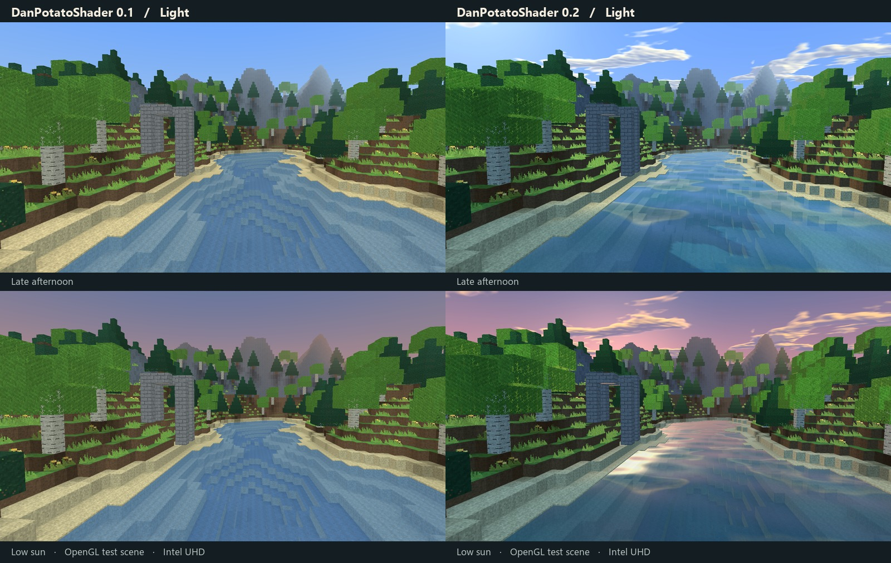

# DanPotatoShader

A shader pack for **Minecraft Java 1.21.1, Fabric, and Iris**, designed for Intel UHD integrated graphics. At a riverbank, the low sun lights the edges of stone and foliage, nearby trees cast shadows, and ripples break up the reflected sky. Both profiles include these effects.

**[Download DanPotatoShader 0.2.0 beta](https://github.com/Haigatu/DanPotatoShader/releases/download/v0.2.0-beta/DanPotatoShader-0.2.0-beta.zip)** · [Release notes](https://github.com/Haigatu/DanPotatoShader/releases/tag/v0.2.0-beta)



*Offline OpenGL comparison on Intel UHD. Each row uses identical geometry, textures, camera, and lighting inputs. The fixture uses procedural block textures and omits the game's stock cloud mesh. Minecraft gameplay testing for this release is pending.*

## Install

1. Use **Minecraft Java 1.21.1**, **64-bit Java 21**, and a compatible **Fabric Loader 0.16.0 or later**. Install the Fabric builds of Iris and Sodium for 1.21.1. This pack targets [Iris 1.8.8](https://modrinth.com/mod/iris/version/1.8.8%2B1.21.1-fabric) and [Sodium 0.6.13](https://modrinth.com/mod/sodium/version/mc1.21.1-0.6.13-fabric).
2. Open the shader pack folder from the Iris video settings and place **DanPotatoShader-0.2.0-beta.zip** inside it. Keep the archive zipped. Prism Launcher has a separate folder for each instance.
3. Select **DanPotatoShader-0.2.0-beta.zip** and apply. **Light** is the default. Shader settings, profile names, and tooltips follow Minecraft's language and include English and Russian.

## Profiles

| Setting | Light · default | Balanced |
| --- | --- | --- |
| Nearby terrain and foliage shadows | 384 × 384, 24 blocks | 512 × 512, 32 blocks |
| Cloud layer | Painted sky and its water reflection | Also casts moving shade on sunlit ground |
| Sky reflection and ripples | On | On |
| Shoreline depth | Off | One opaque-depth read on visible water |
| Foliage wind and copper edges | On | On |

For an i5-12450H with Intel UHD and 16 GB DDR4, start with **Light at 1600 × 900, 8 chunks of render distance, and 5 chunks of simulation distance**. If frame times are uneven, turn off **Cast shadows** first. This skips the extra geometry pass and keeps the painted sky, tinted lighting, and moving water. Try 1280 × 720 if pixel cost is still limiting. All water features switch independently. The **Cloud layer** setting cycles between game clouds, painted clouds, and painted clouds with moving ground shade.

## How it works

- **Light and leaves.** The vertex shader samples Minecraft's lightmap and separates cool ambient light from direct sunlight. Open sides of leaves and grass transmit some light. Torches retain a warm falloff. Short grass bends from its base, tall plants bend continuously across both blocks, and the shadow pass uses the same displacement as the foliage.
- **Clouds.** A single 256 × 256 RGBA tile holds cloud density, two lighting slopes, and a smoother density field for rough water. The sky shader projects this tile onto one drifting plane, colors it with the current sun or moon direction, and dims the visible sun, moon, and stars behind it. Balanced samples the same field at terrain vertices for moving patches of shade. The tile occupies 256 KiB as RGBA8. [Cloud-field generator](https://github.com/Haigatu/DanPotatoShader/blob/v0.2.0-beta/tools/bake_cloudfield.py)
- **Water.** Two moving wave directions shape the reflected light. Fresnel weighting brings out the sky at shallow viewing angles. The reflection samples the smoother cloud field to keep distant highlights stable. Balanced compares the water with the depth of the opaque scene to leave the shore more transparent and tint deeper pools. The reflection contains sky and clouds. Objects on the banks do not appear in it.
- **Stone and distance.** Low sunlight catches the upper courses of full masonry blocks, with the highlight fading before it becomes subpixel. Distant outdoor terrain picks up the biome's fog color. One final color sample shapes midtone contrast while preserving the black and white endpoints.

The Overworld uses the custom sun, clouds, wind, water, and shadows. The Nether and End keep their own light and fog with the shared final color grade. The pack writes one scene color target, reads no frame history, and uses no volumetric ray marching, SSR, or bloom chain. The optional shadow map covers opaque and cutout terrain. Mobs, translucent blocks, and block entities do not cast into it. Low shadow-map resolutions can show steps on thin silhouettes.

## Performance and verification

The GPU measurements below came from the same standalone riverbank scene on **Intel UHD Graphics**, driver **32.0.101.7088**, at **1600 × 900**. The fixture submitted 41,099 quads in the main scene. OpenGL timer queries covered rendering, including enabled shadow, water-depth, and final-color work. Forty samples per configuration were taken after warm-up, rotating the measurement order.

| Configuration | Median GPU time | 95th percentile |
| --- | ---: | ---: |
| 0.1 Light | 1.54 ms | 1.57 ms |
| 0.2 Light | 2.77 ms | 3.14 ms |
| 0.2 Light with cast shadows off | 2.36 ms | 2.71 ms |
| 0.2 Balanced | 3.36 ms | 3.72 ms |

These timings cover this synthetic workload. In-game FPS, frame pacing during chunk loading, and total graphics memory use have not been measured for 0.2.

The Iris 1.8.8 parser processed the release ZIP and recognized both profiles, all nine settings, and 25 English and Russian UI entries per language. The OpenGL driver compiled and linked 18 programs across 194 configurations. Both shipping profiles also compiled and linked after Iris's core-profile transformations. Pixel readbacks covered lighting, shadow depth and cutouts, water, material masks, sky colors, fog, and color grading.

## Files and packaging

| Location | Contents |
| --- | --- |
| `shaders/` | Base programs, profile settings, dimension mapping, and block IDs |
| `shaders/overworld/` | Terrain, water, sky, entities, hand, shadow, and final program entry points |
| `shaders/lib/` | Shared lighting, cloud projection, water, foliage wind, fog, and color-grading code |
| `shaders/textures/` | Packed cloud field and its sampling metadata |
| `shaders/lang/` | English and Russian menu strings |
| `tools/`, `docs/` | Offline texture generator and comparison image, excluded from the installable ZIP |

To package a clone, run this command at the repository root.

```sh
git archive --format=zip --output=DanPotatoShader-0.2.0-beta.zip HEAD README.md shaders
```

## References

The GLSL and cloud texture were created for this pack. Structure and shadow mapping follow the [Iris reference](https://shaders.properties/current/reference/overview/), [Iris documentation repository](https://github.com/IrisShaders/docs), [Base-330](https://github.com/shaderLABS/Base-330), and [Shadow Tutorial](https://github.com/shaderLABS/Shadow-Tutorial). Independent quality controls were informed by [MakeUp Ultra Fast](https://github.com/javiergcim/MakeUpUltraFast) and its [developer notes](https://github.com/javiergcim/MakeUpUltraFast/blob/master/ForDevelopers.EN.md). Additional visual references included [Photon](https://github.com/sixthsurge/photon), [Bliss](https://github.com/X0nk/Bliss-Shader), and [Revelation](https://github.com/HaringPro/Revelation).
